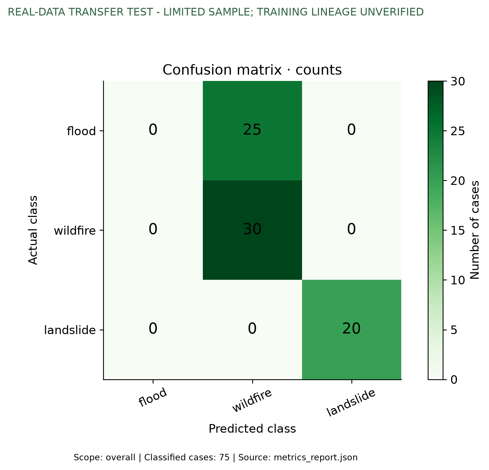
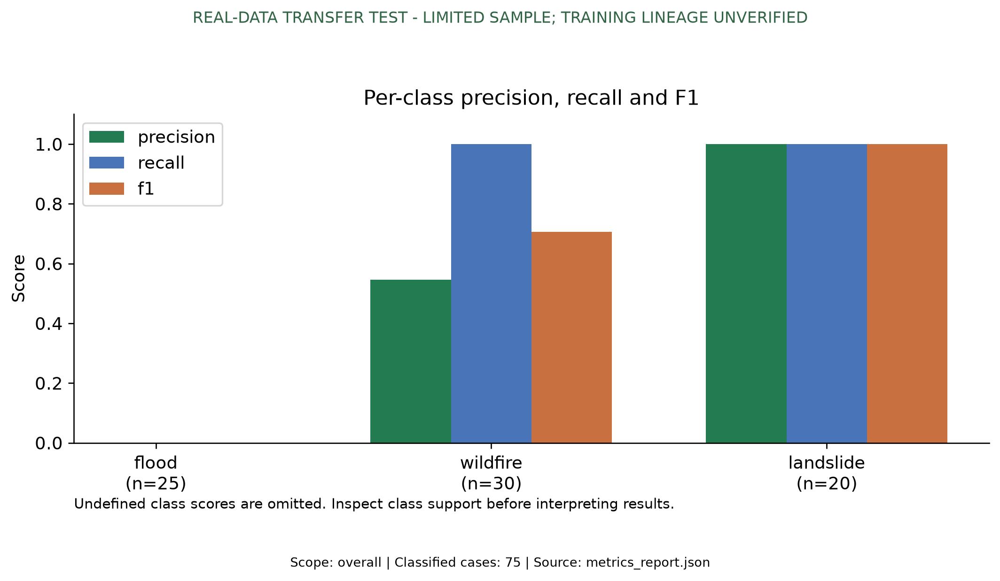
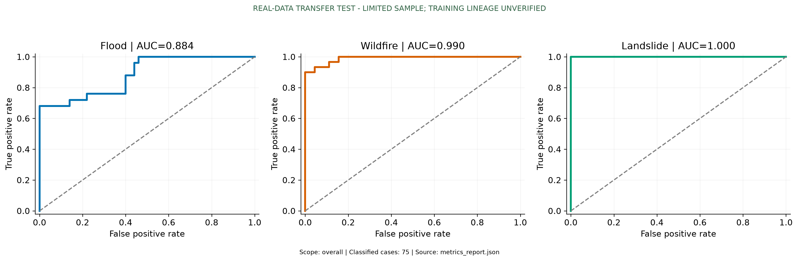
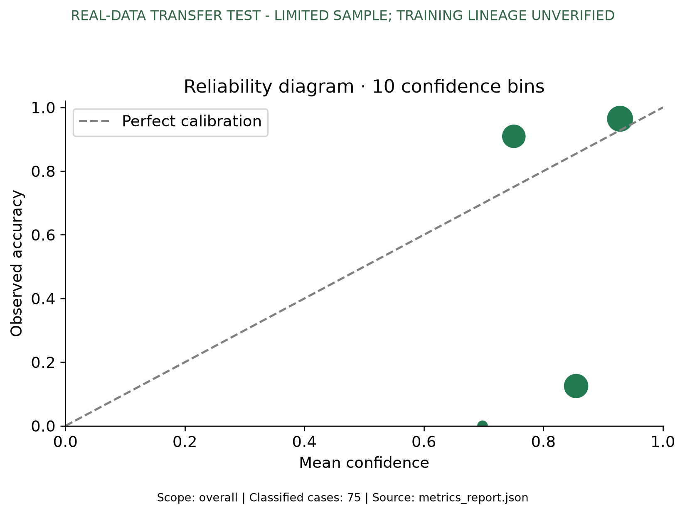

# MultiHazard-VLM
## Detailed Project Report

**Project:** MultiHazard-VLM: Vision-Language Framework for Multi-Hazard Mapping

**Team:** Team D15

**Institution:** Amrita School of AI, Coimbatore

**Project directory:** `d:\sem7\hazard`

---

## 1. Abstract

MultiHazard-VLM is an Earth observation and geospatial intelligence platform designed to analyze three major natural hazards:

- Floods
- Wildfires
- Landslides

The system combines satellite imagery, geospatial context, deep learning, a FastAPI inference service, and an interactive React map dashboard. A user can inspect administrative boundaries, hover over districts for their names, select a point on the map, request a hazard analysis, and view the predicted hazard type, probability distribution, impact radius, affected area, live weather, and advisory report.

The model architecture uses a spatiotemporal visual backbone, H3 geospatial encoding, cross-attention fusion, and specialized prediction heads. The service also includes India boundary validation, live weather lookup, response caching, database integration, Prometheus metrics, Docker deployment, and Kubernetes deployment material.

---

## 2. Objectives

The primary objectives are:

1. Build a unified model for flood, wildfire, and landslide analysis.
2. Combine optical and radar satellite information with geospatial attributes.
3. Localize the predicted event using geographic coordinates.
4. Estimate the impact radius and affected area.
5. Generate a human-readable hazard advisory.
6. Provide an interactive map-based user interface.
7. Support live weather lookup for the selected map point.
8. Validate geographic inputs before model inference.
9. Expose the system through documented REST API endpoints.
10. Support local, Docker, and Kubernetes deployment patterns.

---

## 3. System Overview

The platform is organized into five major layers:

```text
User and Map Interface
        |
React + Vite + React Leaflet Dashboard
        |
FastAPI REST Service
        |
Data Acquisition and Preprocessing
        |
MultiHazard-VLM Model
        |
Hazard, Coordinates, Radius, and Advisory Outputs
```

### 3.1 User interface layer

The active dashboard is implemented in `web/src/App.jsx` using React, Vite, and React Leaflet. It provides:

- India-focused map visualization.
- State and district boundaries.
- District hover information.
- District/state-name tooltips on hover.
- Live weather lookup for the selected point.
- Point selection for hazard analysis.
- Hazard probability display.
- Impact radius display.
- Affected-area calculation.
- Advisory report display.
- Downloadable text reports.

### 3.2 API layer

The backend is implemented in `api/app.py` using FastAPI and Uvicorn. It is responsible for:

- Request validation.
- Geographic boundary validation.
- Weather retrieval.
- Model loading.
- Satellite-data inference flow.
- Demo inference flow.
- Database persistence.
- Prediction caching.
- Health and monitoring endpoints.

### 3.3 Data layer

The data layer includes:

- Dataset loaders for training data.
- Raster preprocessing.
- H3 spatial encoding.
- Planetary Computer access.
- PostgreSQL persistence.
- Redis caching.
- Evaluation utilities.

### 3.4 Model layer

The model layer contains:

- Spatiotemporal Mamba visual backbone.
- H3-based geospatial prompt encoder.
- Cross-attention fusion module.
- Hazard classification head.
- Coordinate regression head.
- Impact-radius estimation head.
- Language reasoning head.

---

## 4. Model Architecture

```text
Sentinel-1 SAR + Sentinel-2 Optical Imagery
                 |
       Preprocessing and Quality Masks
                 |
     Spatiotemporal Mamba Backbone
                 |
        Visual Feature Representation
                 |
     H3 Geospatial Prompt Encoder
                 |
       Terrain and Location Attributes
                 |
        Cross-Attention Fusion Layer
                 |
   -----------------------------------------
   |                 |                     |
Hazard Head     Coordinate Head       Radius Head
   |                 |                     |
Hazard Type     Predicted Location     Radius (km)
                 |
          Language Reasoner
                 |
          Advisory Report
```

### 4.1 Spatiotemporal visual backbone

The backbone processes image sequences containing multiple time steps and multiple sensor channels. The architecture uses Mamba-style sequence blocks to model spatial and temporal dependencies efficiently.

Configured input characteristics include:

- Ten input channels.
- Maximum temporal sequence length of thirty.
- Configurable image size.
- Patch-based visual processing.
- Quality flags for missing or invalid frames.

### 4.2 Geospatial prompt encoder

The geospatial prompt encoder represents geographic context using H3 cells at multiple resolutions:

- Resolution 4 for broad regional context.
- Resolution 6 for district-scale context.
- Resolution 8 for fine localization.

It also uses terrain attributes:

- Elevation.
- Slope.
- NDVI.
- Aspect.
- Lithology class.

### 4.3 Fusion layer

The visual and geospatial representations are combined through cross-attention. This allows the model to use both image evidence and location-specific context when producing predictions.

### 4.4 Prediction heads

The prediction heads are separated by responsibility:

- Hazard classification: flood, wildfire, or landslide.
- Coordinate regression: predicted latitude and longitude.
- Radius estimation: estimated impact radius in kilometers.
- Language reasoning: structured advisory text.

This separation makes numeric and language outputs independently inspectable.

---

## 5. Datasets and External Sources

| Purpose | Dataset or service |
|---|---|
| Flood analysis | S1S2-Water dataset |
| Wildfire analysis | HLS Burn Scars dataset |
| Landslide analysis | CAS Landslide dataset |
| Satellite data access | Microsoft Planetary Computer |
| Weather data | Open-Meteo |
| Administrative boundaries | Bundled India GeoJSON files |
| Spatial indexing | H3 |

### 5.1 Satellite data

The Planetary Computer integration searches public STAC collections and loads recent Sentinel scenes for a requested geographic area. The configured collections include:

- `sentinel-1-grd`
- `sentinel-2-l2a`

The Sentinel-1 path uses VV and VH radar bands. The Sentinel-2 path uses:

- B02: Blue
- B03: Green
- B04: Red
- B08: Near infrared
- B11: SWIR 1
- B12: SWIR 2

### 5.2 Weather data

The weather endpoint uses Open-Meteo current conditions and returns:

- Temperature.
- Apparent temperature.
- Relative humidity.
- Precipitation.
- Rain.
- Cloud cover.
- Wind speed.
- Wind direction.
- Weather code.
- Human-readable condition.
- Observation timestamp.
- Timezone.

Weather responses are cached in memory for five minutes to make repeated district hover operations faster.

---

## 6. Geographic Validation

The application is designed for India-focused mapping. Requests are checked against:

1. Global latitude and longitude limits.
2. The India geographic bounding box.
3. The bundled India administrative boundary geometry.

Requests outside the supported area are rejected before inference. This prevents locations outside India from being sent into the dashboard prediction workflow.

The validation is applied to:

- Point prediction requests.
- AOI prediction requests.
- Ingestion requests.
- Weather requests.

---

## 7. Dashboard Workflow

### 7.1 Application startup

When the dashboard starts:

1. Vite serves the React single-page application.
2. Bundled administrative boundary GeoJSON files are loaded.
3. The Leaflet India map is created with OpenStreetMap tiles.
4. State boundaries and labels are rendered.
5. District polygons are rendered.
6. District hover tooltips and highlight handlers are attached.
7. The map is displayed to the user.

### 7.2 District hover workflow

When the cursor enters a district polygon:

1. The district and state names are read from GeoJSON properties.
2. A tooltip opens beside the cursor.
3. The polygon is highlighted while hovered.
4. The tooltip closes when the cursor leaves the district.

Live weather is requested separately for the selected point and displayed above the map.

### 7.3 Point prediction workflow

When the user clicks the map:

1. The clicked latitude and longitude are captured.
2. The dashboard updates the coordinate controls and requests current weather.
3. The user submits a point prediction request to the API.
4. The API validates the coordinate.
5. The inference pipeline produces a prediction.
6. The dashboard displays hazard information and the impact circle.
7. The response can be downloaded as a text report.

---

## 8. REST API Reference

The local API base URL is:

```text
http://localhost:8000/api/v1
```

### 8.1 Health check

```http
GET /api/v1/health
```

Returns service and component status.

### 8.2 Weather

```http
GET /api/v1/weather?latitude={latitude}&longitude={longitude}
```

Returns current Open-Meteo conditions for a validated point.

### 8.3 Point prediction

```http
POST /api/v1/predict-point
```

Example request:

```json
{
  "latitude": 13.08,
  "longitude": 80.27,
  "country_boundary": null
}
```

The response includes:

- Status.
- Inference mode.
- Data source.
- Predicted coordinates.
- Hazard type.
- Hazard probabilities.
- Impact radius.
- Affected area.
- Advisory language.
- Cache information.

### 8.4 AOI prediction

```http
POST /api/v1/predict
```

The AOI format is:

```text
[min_latitude, min_longitude, max_latitude, max_longitude]
```

### 8.5 Data ingestion

```http
POST /api/v1/ingest
```

Example request:

```json
{
  "aoi_bounds": [10.0, 70.0, 15.0, 75.0],
  "date_start": "2026-08-01",
  "date_end": "2026-09-16"
}
```

### 8.6 Statistics

```http
GET /api/v1/stats
```

Returns prediction statistics stored by the persistence layer.

### 8.7 Prometheus metrics

```http
GET /metrics
```

Returns Prometheus-compatible metrics for requests, predictions, latency, cache behavior, and database activity.

### 8.8 Dashboard data

```http
GET /api/v1/dashboard/data
POST /api/v1/dashboard/data
```

Returns dashboard-compatible prediction information.

---

## 9. Project Structure

```text
hazard/
├── api/
│   ├── __init__.py
│   └── app.py
├── dashboard/
│   ├── __init__.py
│   ├── app.py
│   └── boundaries/
│       ├── india_districts.geojson
│       └── india_states.geojson
├── data/
│   ├── cache.py
│   ├── database.py
│   ├── datasets.py
│   ├── h3_encoder.py
│   ├── metrics.py
│   ├── planetary_computer.py
│   ├── preprocessing.py
│   └── ingestion_cron.py
├── models/
│   ├── fusion.py
│   ├── multihazard_vlm.py
│   ├── prompt_encoder.py
│   ├── backbone/
│   └── heads/
├── evaluation/
├── tests/
├── checkpoints/
├── configs/
├── train.py
├── inference.py
├── demo_output.py
├── docker-compose.yml
├── Dockerfile
├── start.bat
├── requirements.txt
└── README.md
```

---

## 10. Configuration

The main model configuration is stored in `configs/model_config.yaml`.

Important values include:

```yaml
model:
  embed_dim: 256
  num_heads: 8
  patch_size: 16
  num_input_channels: 10
  max_seq_len: 30
  img_size: 64
  h3_resolutions: [4, 6, 8]
  num_geo_attributes: 5
  radius_clamp_min: 0.1
  radius_clamp_max: 30.0
```

Data configuration includes:

- Raster tile size.
- Tile overlap.
- Sentinel-1 bands.
- Sentinel-2 bands.
- Ingestion cadence.
- Rolling lookback window.

Deployment configuration includes:

- API port: `8000`.
- Dashboard port: `8503`.

---

## 11. Installation and Local Setup

### 11.1 Create the environment

```powershell
cd d:\sem7\hazard
python -m venv .venv
.\.venv\Scripts\activate
```

### 11.2 Install dependencies

```powershell
pip install -r requirements.txt
```

### 11.3 Start the full local stack

```powershell
.\start.bat
```

The expected local addresses are:

- Dashboard: http://localhost:8503
- API documentation: http://localhost:8000/docs
- API health: http://localhost:8000/api/v1/health
- Metrics: http://localhost:8000/metrics

### 11.4 Start services manually

API terminal:

```powershell
.\.venv\Scripts\python.exe -m uvicorn api.app:app --host 0.0.0.0 --port 8000
```

React dashboard terminal:

```powershell
cd web
npm install
npm run dev
```

---

## 12. Training and Inference

### 12.1 Training

```powershell
.\.venv\Scripts\python.exe train.py --epochs 5 --batch_size 2 --img_size 64 --checkpoint_dir checkpoints
```

### 12.2 Resume training

```powershell
.\.venv\Scripts\python.exe train.py --epochs 10 --batch_size 2 --img_size 64 --checkpoint_dir checkpoints --resume checkpoints\model_epoch_5.pt
```

### 12.3 Standalone inference

```powershell
.\.venv\Scripts\python.exe inference.py --checkpoint checkpoints\model_epoch_9.pt
```

### 12.4 Demo output

```powershell
.\.venv\Scripts\python.exe demo_output.py
```

---

## 13. Testing and Verification

The project includes pipeline tests covering:

- Dataset loading.
- Georeferenced sample validation.
- Train/validation dataset separation.
- Model forward-pass compatibility.
- Evaluation module integration.
- Dashboard API payload structure.
- Checkpoint positional-embedding adaptation.

Run the tests with:

```powershell
.\.venv\Scripts\python.exe -m pytest tests\test_pipeline.py -v
```

Python syntax validation:

```powershell
python -m py_compile api\app.py dashboard\app.py
```

Diff and whitespace validation:

```powershell
git diff --check
```

Runtime checks:

```powershell
Invoke-RestMethod http://localhost:8000/api/v1/health
Invoke-RestMethod "http://localhost:8000/api/v1/weather?latitude=13.08&longitude=80.27"
```

---

### 13.1 Measured classification performance: real-public-data transfer test

The unchanged `checkpoints/model_epoch_9.pt` checkpoint was run on 27 October 2026. Ninety public image/annotation pairs were acquired with seed 20261027; 15 mask-empty patches were excluded, leaving 75 eligible cases. No retraining, checkpoint search or threshold tuning was performed.

| Metric | Measured result |
| --- | ---: |
| Accuracy | 66.67% (50/75) |
| Macro precision | 51.52% |
| Macro recall | 66.67% |
| Macro F1 | 56.86% |
| Weighted F1 | 54.90% |
| Cohen's kappa | 0.475524 |
| Multiclass MCC | 0.595850 |
| Log loss | 0.993309 |
| Multiclass Brier score | 0.557037 |
| Ten-bin ECE | 0.302812 |

| Source class | Cases | Precision | Recall | F1 | ROC-AUC |
| --- | ---: | ---: | ---: | ---: | ---: |
| Flood-source | 25 | Undefined: no flood predictions | 0% | 0% | 0.884000 |
| Burn scar / wildfire | 30 | 54.55% | 100% | 70.59% | 0.989630 |
| Landslide | 20 | 100% | 100% | 100% | 1.000000 |

Rows are reference labels; columns are predicted flood, wildfire and landslide:

```text
              Predicted
Actual        flood wildfire landslide
flood           0      25        0
wildfire        0      30        0
landslide       0       0       20
```

All 25 flood-source patches were predicted as wildfire. AUC describes score ranking as thresholds change; it does not override the zero flood recall under the actual argmax rule. Undefined flood precision contributes zero in the macro-precision calculation.









[Full result viewer](evaluation/real_transfer/figures/overall/index.html) · [Saved metrics](evaluation/real_transfer/metrics_report.json) · [Protocol and interpretation](evaluation/REAL_TRANSFER_PROTOCOL.md)

This is a positive-only source-domain transfer diagnostic, not a certified unseen or operational hazard benchmark. The checkpoint lacks a historical training manifest, so complete training exclusion cannot be proven. Different source datasets, sensors and channel layouts are confounded with class; input adaptation and missing geographic context limit interpretation. Flood-source labels describe water in flood-event imagery; burn scars describe past burning rather than active fire. The HLS converted test split aliases official validation. No non-event, trained segmentation, localization, vulnerability or language-quality result is claimed. The separate strict benchmark remains incomplete, and the older 100% generated smoke scores are not the model-performance result.

The three source-adapter checks passed; confusion-matrix, accuracy and macro metrics independently matched scikit-learn. The ROC and confusion-matrix images were visually inspected.

## 14. Storage, Caching, and Monitoring

### 14.1 PostgreSQL

The database layer stores:

- Requested coordinates.
- Predicted coordinates.
- Hazard type.
- Hazard probabilities.
- Impact radius.
- Affected area.
- Advisory report.
- Model version.
- Timestamps.

### 14.2 Redis

Redis is used for:

- Prediction response caching.
- Statistics caching.
- Lower-latency repeated requests.
- Graceful degradation when unavailable.

### 14.3 In-memory weather cache

The weather endpoint maintains a five-minute process-local cache. This is particularly useful for district hover operations because the user may enter and leave the same polygon repeatedly.

### 14.4 Prometheus and Grafana

The deployment includes Prometheus and Grafana configuration for:

- API request totals.
- Prediction totals by hazard type.
- Request latency.
- Prediction latency.
- Cache hits and misses.
- Database query timings.
- Active requests.

---

## 15. Docker Deployment

Start the Docker stack with:

```powershell
docker compose up -d --build
```

The stack includes:

- PostgreSQL with PostGIS.
- Redis.
- FastAPI API service.
- React dashboard served by Nginx.
- Prometheus.
- Grafana.

Expected public service addresses:

- Dashboard: http://localhost:8504
- API: http://localhost:8000
- Prometheus: http://localhost:9090
- Grafana: http://localhost:3000

Check service status:

```powershell
docker compose ps
```

View API logs:

```powershell
docker compose logs -f api
```

View dashboard logs:

```powershell
docker compose logs -f dashboard
```

---

## 16. Kubernetes Deployment

The Kubernetes manifest defines an API deployment and service, configuration values, resource requests, GPU limits, and health probes.

Typical commands:

```powershell
kubectl apply -f deployment\k8s-manifest.yaml
kubectl get pods
kubectl get services
kubectl logs deployment/multihazard-api-deployment
```

For production, configure:

- Image registry credentials.
- Database secrets.
- Redis secrets.
- API ingress.
- TLS certificates.
- GPU node scheduling.
- Persistent storage.
- External monitoring.

---

## 17. Security and Reliability

Recommended production controls include:

1. Replace development database credentials.
2. Store credentials in environment secrets.
3. Restrict metrics access.
4. Add authentication to administrative endpoints.
5. Configure HTTPS through Nginx or an ingress controller.
6. Apply API rate limits.
7. Validate all uploaded or externally fetched data.
8. Maintain model and data version identifiers.
9. Record acquisition timestamps for every analysis.
10. Monitor external API failures and retry behavior.
11. Keep backup copies of trained checkpoints.
12. Use structured logging and alerting.

---

## 18. Known Operational Considerations

- Satellite coverage varies by location and date.
- Cloud cover can reduce optical-data quality.
- Radar and optical acquisitions may not have identical timestamps.
- External data services can experience latency or temporary failure.
- Missing sensors should be reported in the response source metadata.
- A prediction should be reviewed alongside source imagery and confidence values.
- Model outputs require validation against labeled events and domain expertise before operational decisions.

---

## 19. Future Enhancements

1. Add calibrated confidence and uncertainty estimates.
2. Add event-history comparison for the selected district.
3. Add image previews from the exact satellite acquisition.
4. Add temporal change-detection visualizations.
5. Add district-level historical weather summaries.
6. Add model explainability maps.
7. Add automated retraining from newly labeled events.
8. Add offline satellite-scene caching.
9. Add asynchronous job queues for long-running inference.
10. Add role-based access control.
11. Add automated CI testing and deployment.
12. Add regional support beyond India after boundary and dataset validation.

---

## 20. Conclusion

MultiHazard-VLM provides an integrated framework for multi-hazard mapping using Earth observation data and geospatial context. Its modular architecture separates data ingestion, preprocessing, model inference, API serving, dashboard rendering, persistence, and monitoring.

The current implementation provides a strong foundation for academic demonstration, experimentation, and continued operational development. The project includes a trained-model workflow, map-based interaction, district-level hover weather, geographic validation, live external data integration, API documentation, test coverage, and deployment resources.

---

## Appendix A: Useful Commands

```powershell
# Activate environment
.\.venv\Scripts\activate

# Start the project
.\start.bat

# Run tests
python -m pytest tests\test_pipeline.py -v

# Validate Python files
python -m py_compile api\app.py dashboard\app.py

# Check API health
Invoke-RestMethod http://localhost:8000/api/v1/health

# Check weather
Invoke-RestMethod "http://localhost:8000/api/v1/weather?latitude=13.08&longitude=80.27"

# Open API docs
Start-Process http://localhost:8000/docs

# Open dashboard
Start-Process http://localhost:8503
```
